<h3 align="center">BurdenBoy </h3>

  <a href="https://burdenboy.github.io/deadlockplus/"><b>Сайт</b></a> ·
  <a href="https://github.com/BurdenBoy/deadlockplus/releases/latest"><b>Скачать Deadlock Plus</b></a>

